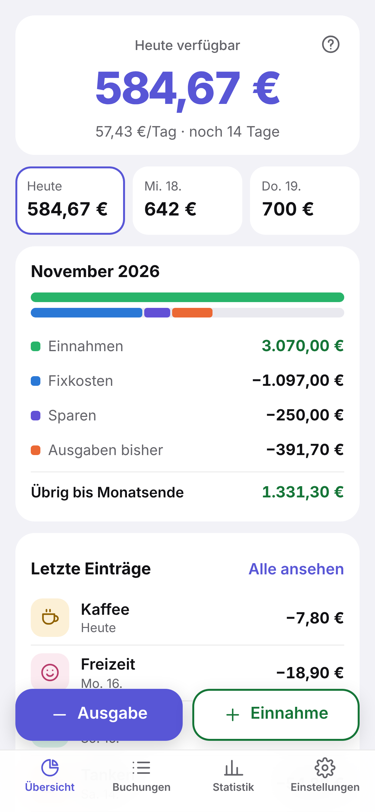
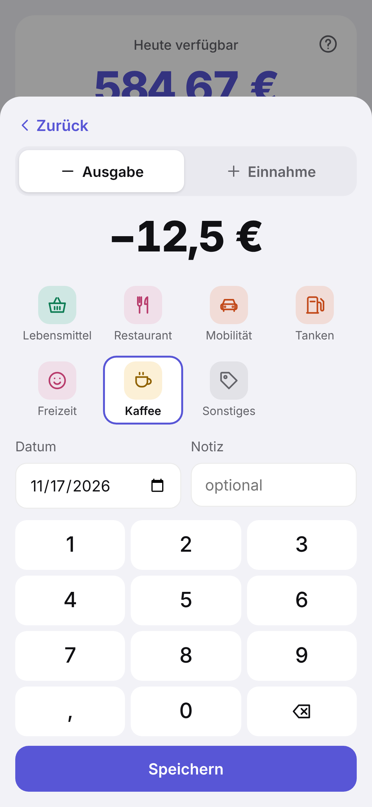
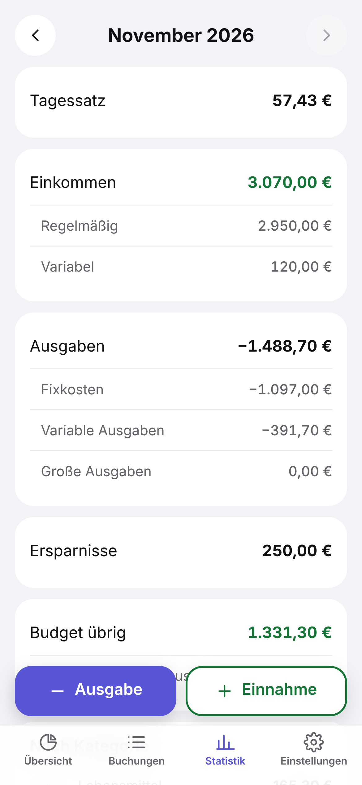
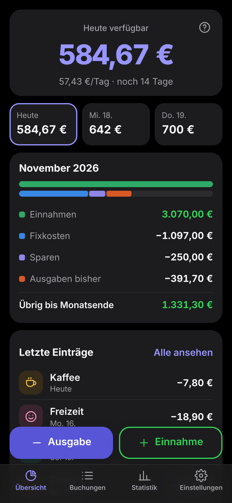

<p align="center"></p>

<h1 align="center">Münzwerk Lite</h1>

<p align="center"><b>Ein Haushaltsbuch fürs Handy.</b> Ausgaben eintippen, sehen, was heute noch drin ist.<br>
Läuft offline, ohne Konto, ohne Bankverbindung – deine Daten verlassen das Gerät nicht.</p>

<p align="center"><a href="https://vaitage.github.io/muenzwerk-lite/"><b>App öffnen</b></a> · <a href="README.md">English</a></p>

<p align="center">
  
  
  
  
</p>

## So funktioniert's

1. **Einmal die festen Posten eintragen:** Gehalt, Miete, Versicherungen, Handy, Sparplan. Sie zählen jeden Monat automatisch.
2. **Tagessatz:** (Einnahmen − Fixkosten − Sparen) ÷ Tage im Monat.
   Beispiel: 3.600 € − 2.253,84 € − 336,54 € = 1.009,62 € ÷ 30 = **33,65 € pro Tag**.
3. **Der Topf:** Jeden Tag kommt der Tagessatz dazu, jede Ausgabe geht ab. Was du nicht ausgibst, bleibt drin.
   Am 8. ohne Ausgaben: heute 269,23 €, morgen 302,89 €, übermorgen 336,54 €.
   200 € Lebensmittel: 69,23 € / 102,89 € / 136,54 €.
4. **Ausgaben und zusätzliche Einnahmen** über zwei große Knöpfe und ein Zahlenfeld – Kategorie antippen, fertig.

Lieber anders? *Einstellungen → Tagesbudget → Neu verteilt* teilt das Übrige jeden Tag auf die restlichen Tage auf.

## Funktionen

- Übersicht: heute verfügbar, die nächsten drei Tage, der Monat auf einen Blick (Einnahmen, Fixkosten, Sparen, ausgegeben, übrig)
- Buchungen nach Tagen, antippen zum Ändern oder Löschen
- Statistik je Monat: Tagessatz, regelmäßige/variable Einnahmen, feste/variable/große Ausgaben, Sparen, Budget übrig, Prognose, Ausgaben nach Kategorie
- Eigene Kategorien und Symbole
- Deutsch und Englisch, hell und dunkel
- **Sicherung als Datei** (Einstellungen → Sicherung) – z. B. in deinem Cloud-Speicher ablegen und auf einem neuen Handy wieder laden

## Installieren (Android)

**https://vaitage.github.io/muenzwerk-lite/** in Chrome öffnen → Menü ⋮ → **App installieren** (oder die Karte „Installieren“ in der App).
Danach startet sie vom Startbildschirm wie eine App und läuft ohne Internet.

Auf dem iPhone: Link in Safari öffnen → Teilen → **Zum Home-Bildschirm**.

> Die Daten liegen nur in diesem Browser auf diesem Handy. Wer die App deinstalliert oder die Websitedaten löscht,
> löscht sie mit – mach ab und zu eine Sicherung.

## Entwicklung

Reines HTML/CSS/JS ohne Build (`web/`). Rechnung in `web/calc.js`, Speicher in `web/store.js` (IndexedDB).

```bash
node --test tests/*.test.mjs                         # Tests
python -m http.server 8765 --directory web           # lokal starten → http://localhost:8765
python tools/screenshots.py de                       # Bilder fürs README (Playwright)
```

Jeder Push auf `main` lässt die Tests laufen und veröffentlicht `web/` auf GitHub Pages.

Münzwerk Lite ist der kleine Bruder von [Münzwerk](https://github.com/Vaitage/Muenzwerk), das die Umsätze automatisch von der Bank holt und auf dem eigenen Server läuft.

## Lizenz

[AGPL-3.0](LICENSE). Hobbyprojekt, ohne Gewähr – wichtige Zahlen bitte selbst prüfen.
