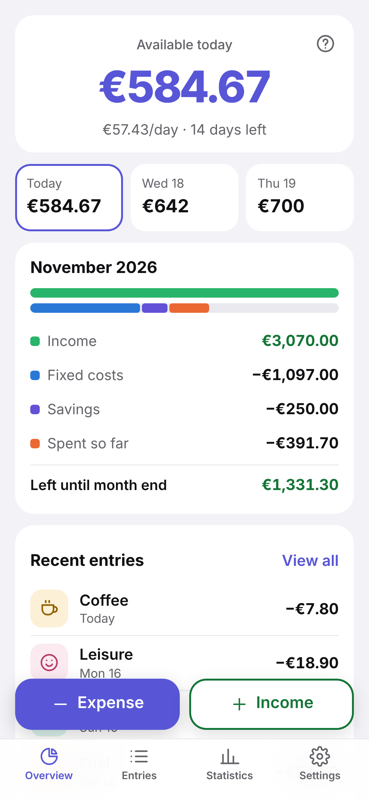
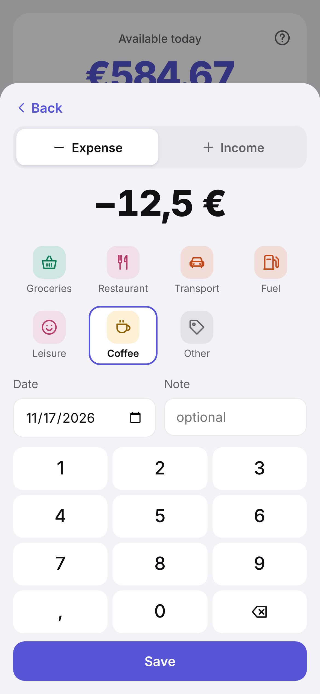
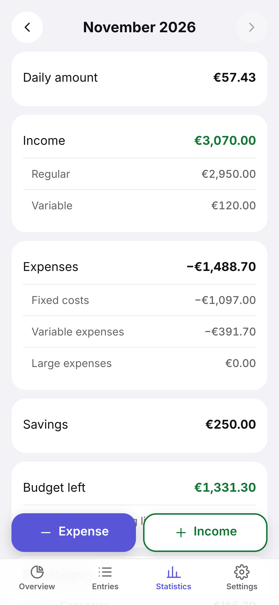
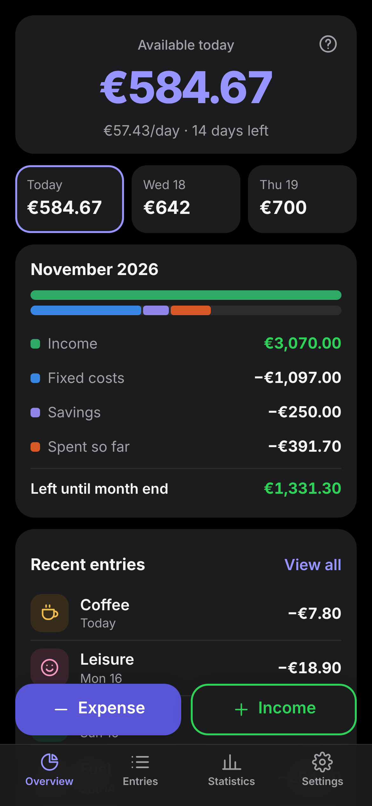

<p align="center"></p>

<h1 align="center">Münzwerk Lite</h1>

<p align="center"><b>A budget book for your phone.</b> Type in what you spend, see what you can still spend today.<br>
Works offline, no account, no bank connection – your data never leaves the device.</p>

<p align="center"><a href="https://vaitage.github.io/muenzwerk-lite/"><b>Open the app</b></a> · <a href="README.de.md">Deutsch</a></p>

<p align="center">
  
  
  
  
</p>

## How it works

1. **Recurring items once:** salary, rent, insurance, phone, savings plan. They count every month automatically.
2. **Daily amount:** (income − fixed costs − savings) ÷ days in the month.
   Example: €3,600 − €2,253.84 − €336.54 = €1,009.62 ÷ 30 = **€33.65 per day**.
3. **The pot:** every day the daily amount is added, every expense is taken out. Whatever you don't spend stays in.
   On the 8th with nothing spent yet: today €269.23, tomorrow €302.89, the day after €336.54.
   Spend €200 on groceries: €69.23 / €102.89 / €136.54.
4. **Expenses and extra income** with two big buttons and a number pad – category, done.

Prefer the old way? *Settings → Daily budget → Spread* divides what's left over the remaining days instead.

## Features

- Overview: available today, the next three days, the month at a glance (income, fixed costs, savings, spent, left)
- Entries by day, edit or delete with a tap
- Statistics per month: daily amount, regular/variable income, fixed/variable/large expenses, savings, budget left, forecast, spending by category
- Your own categories and icons
- German and English, light and dark
- **Backup as a file** (Settings → Backup) – save it to your cloud storage; restore it on a new phone

## Install (Android)

Open **https://vaitage.github.io/muenzwerk-lite/** in Chrome → menu ⋮ → **Install app** (or the “Install” card in the app).
It then starts from the home screen like an app and works without internet.

On an iPhone: open the link in Safari → Share → **Add to Home Screen**.

> Your data lives only in this browser on this phone. Uninstalling the app or clearing site data deletes it –
> make a backup now and then.

## Development

Plain HTML/CSS/JS without a build step (`web/`). Calculations in `web/calc.js`, storage in `web/store.js` (IndexedDB).

```bash
node --test tests/*.test.mjs                         # tests
python -m http.server 8765 --directory web           # run locally → http://localhost:8765
python tools/screenshots.py en                       # README images (Playwright)
```

Every push to `main` runs the tests and publishes `web/` to GitHub Pages.

Münzwerk Lite is the small sibling of [Münzwerk](https://github.com/Vaitage/Muenzwerk), which fetches transactions from the bank automatically and runs on your own server.

## License

[AGPL-3.0](LICENSE). Hobby project, no warranty – check important numbers yourself.
